# Screenshots

From a fresh install, on the real (fake) backend:
- **iOS:** the iPhone 17 Pro simulator, debug build;
- **Android:** the Pixel 10 Pro emulator (API 36), **release build**.

The status bar is set to 9:41 on iOS.

---

## Light

| Feed | Post detail | Search | Create post |
|:---:|:---:|:---:|:---:|
| 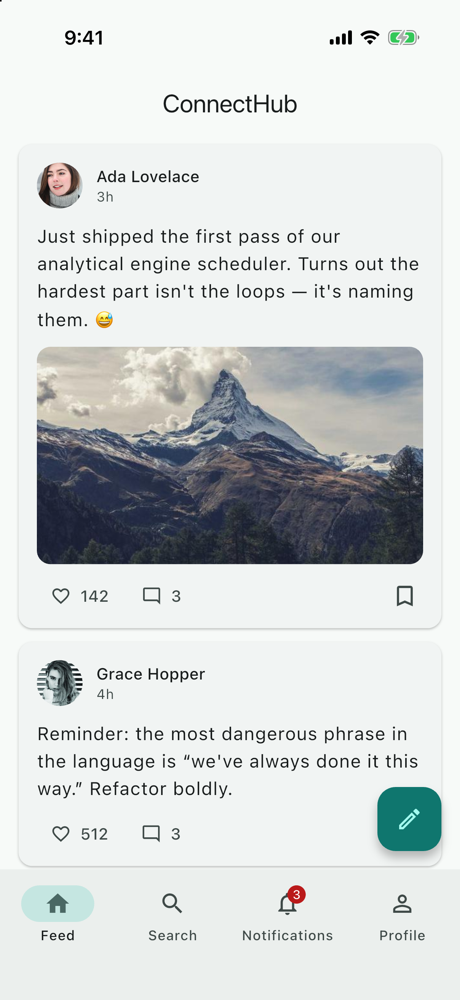 | 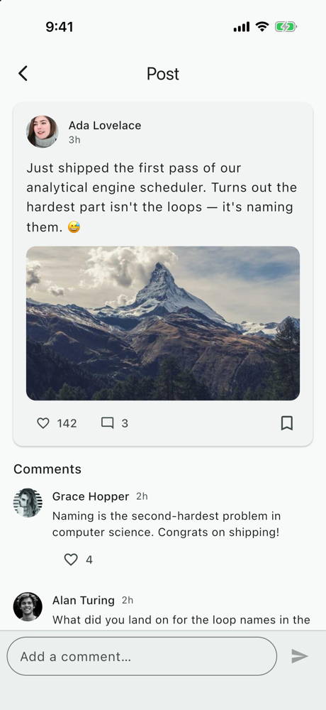 | 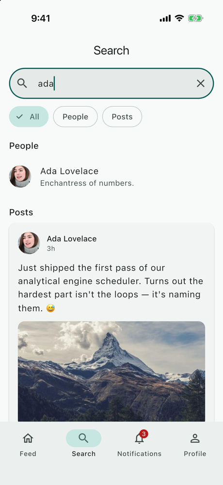 | 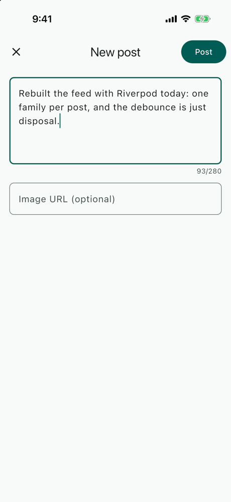 |

| Someone else's profile |
|:---:|
| 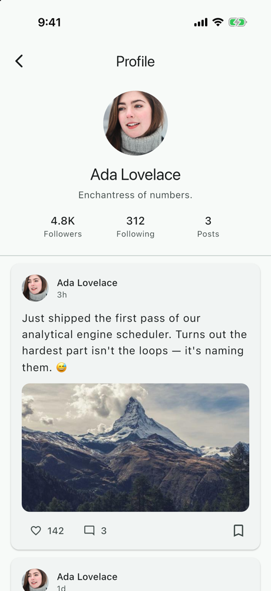 |

## Dark

| Notifications | My profile | Settings |
|:---:|:---:|:---:|
| 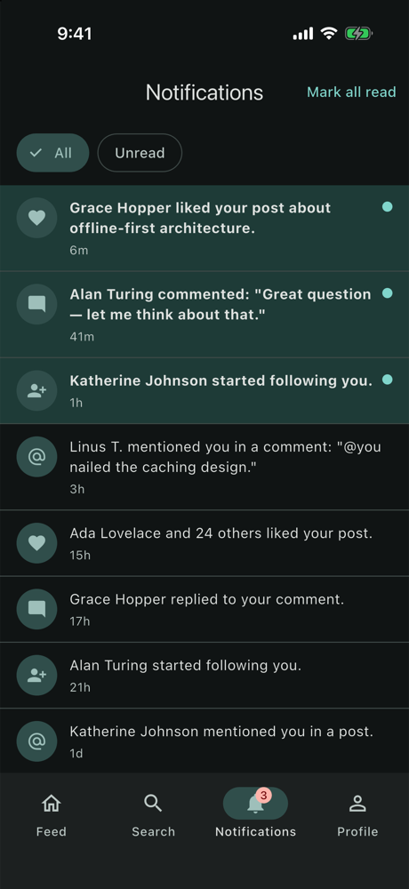 | 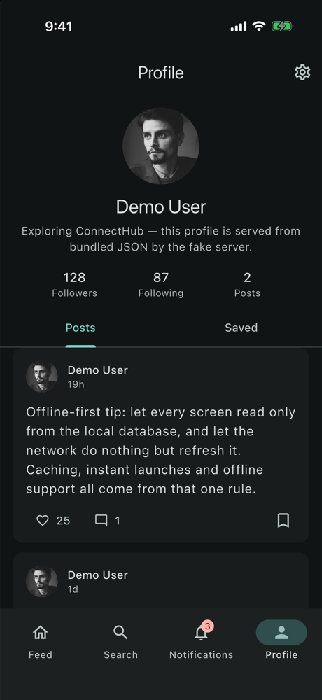 | 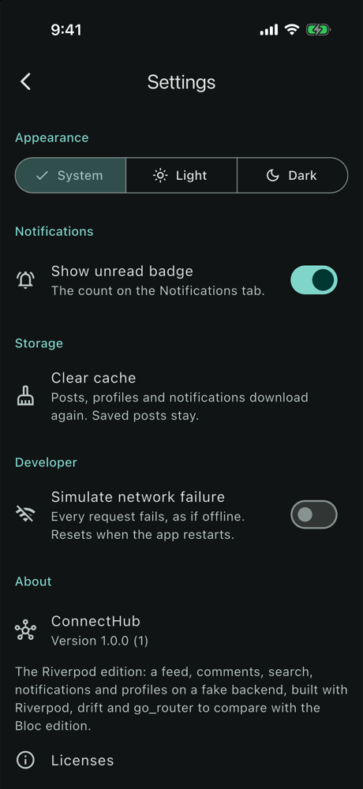 |

## Large text (iOS AX3, about 235 %)

| Feed | My profile | Settings |
|:---:|:---:|:---:|
| 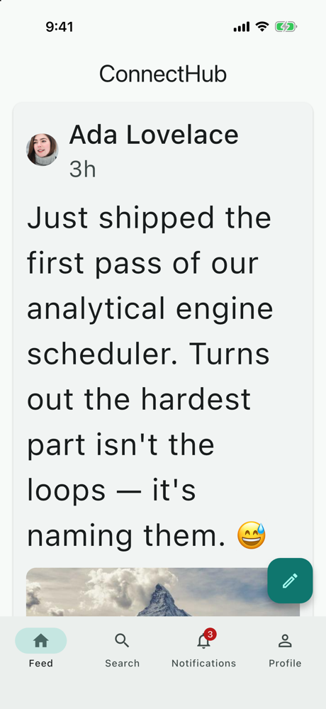 | 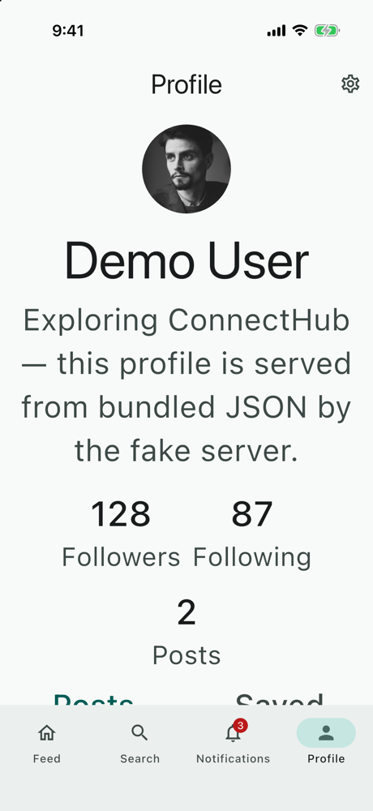 | 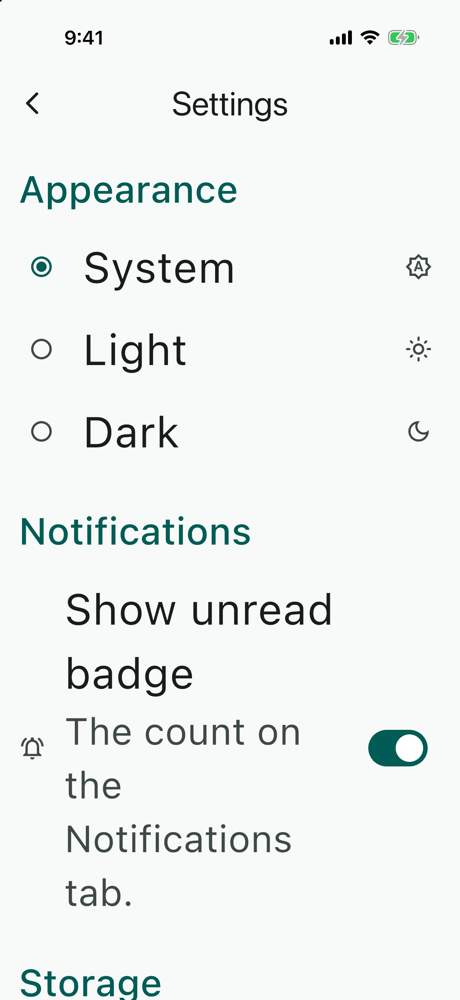 |

At large sizes, side-by-side controls stack (`prefersStackedLayout`, above 130 %):
- Appearance becomes a radio list;
- the profile's counts wrap.

## Wallpaper colors (Android 12+, release build)

| Settings | Feed |
|:---:|:---:|
| 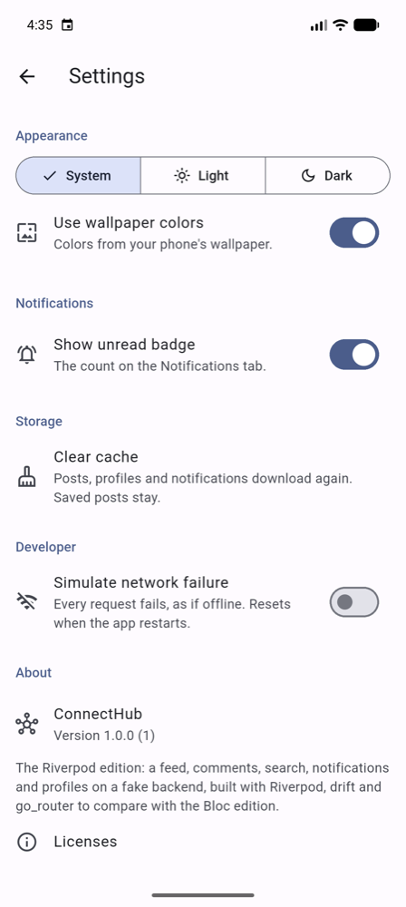 | 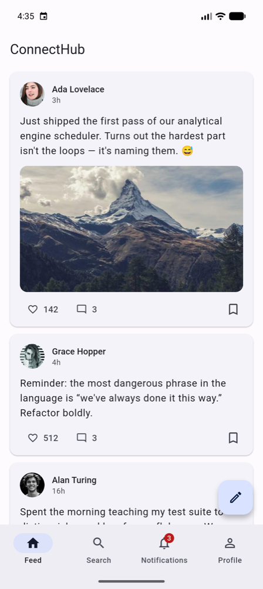 |

- "Use wallpaper colors" appears only where the platform has a palette (`platformColorSchemesProvider` is `null` on iOS).
- Turning it on restyles the app at once, and the choice survives a restart.

---

## How they were taken

```bash
xcrun simctl status_bar <udid> override --time 9:41 --dataNetwork wifi --wifiBars 3 --cellularBars 4 \
  --batteryState charged --batteryLevel 100
xcrun simctl ui <udid> appearance dark                          # or light
xcrun simctl ui <udid> content_size accessibility-extra-large   # AX3; back with `large`
xcrun simctl io <udid> screenshot feed-light.png
sips -Z 1000 feed-light.png                                     # the repo copies are 1000 px tall

fvm flutter build apk --release
adb install -r build/app/outputs/flutter-apk/app-release.apk
adb shell pm clear co.bitfuse.flutter.connect_hub_riverpod      # a fresh install
adb exec-out screencap -p > android-dynamic-color-feed.png
```
